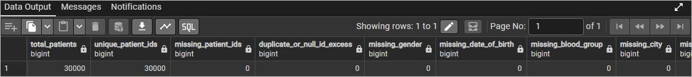
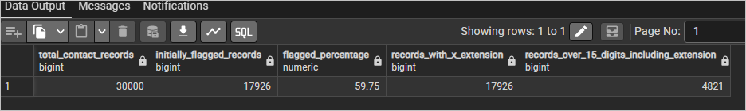
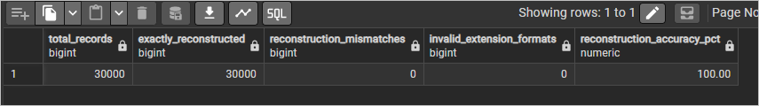
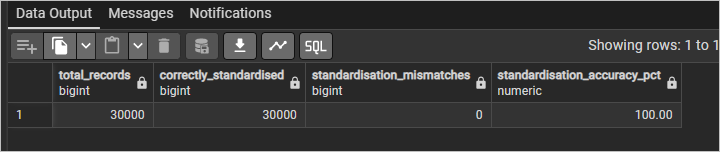

# Healthcare Data Quality Engineering | PostgreSQL

### Case Study 1: Patient Contact Number Cleaning and Validation

**Technologies:** PostgreSQL | SQL | pgAdmin | Regular Expressions | CTEs | Data Quality Validation

**Project focus:** Healthcare Data Analytics, Data Cleaning and Data Quality Engineering

---

## 1. Project Overview

This project investigates and improves patient contact-number data quality in a healthcare dataset containing **30,000 patient records**.

Initial SQL profiling identified **17,926 contact numbers (59.75%)** that failed a preliminary character-format check.

Further investigation showed that these records contained telephone extensions using the `x` convention rather than necessarily being invalid numbers.

I developed a non-destructive PostgreSQL cleaning view to separate telephone numbers from extensions, standardise the numeric component and preserve the original source values.

The project demonstrates a practical data-quality workflow:

**Data Profiling → Root-Cause Investigation → SQL Cleaning → Validation → Documentation**

## 2. Business Problem

Healthcare organisations rely on accurate patient contact information for appointment coordination, communication and administrative processes.

Inconsistent telephone formats can create problems for automated validation and downstream data processing.

The objectives of this project were to:

- Assess patient data completeness and integrity.
- Identify and explain unusual telephone formats.
- Extract telephone extensions without losing information.
- Standardise the main telephone number into a digits-only field.
- Validate the transformation against the original records.
- Document the cleaning decisions and technical limitations.

The solution prioritises data preservation rather than deleting records simply because they fail an initial formatting rule.

## 3. Key Findings and Results

| Data Quality Metric | Result |
|---|---:|
| Total patient records | 30,000 |
| Unique patient IDs | 30,000 |
| Missing patient IDs | 0 |
| Initially flagged contact records | 17,926 |
| Percentage initially flagged | 59.75% |
| Telephone extensions extracted | 17,926 |
| Main telephone number length | 10–13 digits |
| Records passing preliminary 7–15-digit length check | 30,000 |
| Original contact strings reconstructed exactly | 30,000 |
| Reconstruction mismatches | 0 |

**Key finding:** The majority of the apparent contact-format exceptions were explained by the presence of telephone extensions.

These results demonstrate successful parsing and preservation under the formats observed in the dataset. They do not establish that the numbers are active, reachable or valid under national numbering plans.

## 4. SQL Cleaning Methodology

### Stage 1: Patient Data Profiling

Performed SQL checks to assess:

- Total and unique patient records.
- Missing values in key fields.
- Patient identifier integrity.
- Date-of-birth validity.
- Contact-number formatting.

**SQL file:** [01_patient_profiling.sql](01_patient_profiling.sql)

### Stage 2: Contact Format Investigation

Investigated contact strings using PostgreSQL regular expressions.

The analysis identified 17,926 records containing extensions, explaining the initial character-format exceptions.

This stage distinguished between potentially problematic values and values using a recognised formatting convention.

**SQL file:** [02_category_and_contact_diagnostics.sql](02_category_and_contact_diagnostics.sql)

### Stage 3: Non-Destructive Data Cleaning

Created a PostgreSQL view:

`cleaning.patient_cleaned`

The transformation uses CTEs, `CASE`, `SUBSTRING`, `BTRIM` and `REGEXP_REPLACE`.

| Output field | Purpose |
|---|---|
| `contact_number` | Retains the original source value |
| `main_phone_original` | Main number before digits-only standardisation |
| `main_phone_digits` | Main number containing digits only |
| `phone_extension` | Separately extracted extension |
| `phone_quality_status` | Preliminary length-check classification |

The original `public.patient` table remains unchanged.

**SQL file:** [03_create_cleaned_patient_view.sql](03_create_cleaned_patient_view.sql)

### Stage 4: Post-Cleaning Validation

Validation checks were designed to confirm that the cleaning transformation preserved the original data.

The confirmed reconstruction results were:

- 30,000 original contact strings reconstructed exactly.
- Zero reconstruction mismatches.
- 17,926 extensions extracted.
- All 30,000 main numbers satisfied the preliminary length check.

**SQL file:** [04_post_cleaning_validation.sql](04_post_cleaning_validation.sql)

### Stage 5: Synthetic Edge-Case Testing

An additional SQL test script uses fabricated telephone values to examine the behaviour of the cleaning logic under less typical conditions.

The scenarios include:

- Standard lowercase `x` extensions.
- Uppercase `X` extensions.
- Numbers without extensions.
- Leading or trailing whitespace.
- Missing contact values.
- Malformed extension values.
- Alternative extension notation.
- International-style punctuation.

The synthetic test is separate from the patient dataset. Its outcomes should be interpreted from the actual pgAdmin execution results, including any unsupported or failed scenarios.

**SQL file:** [05_synthetic_edge_case tests.sql](05_synthetic_edge_case tests.sql)

## 5. pgAdmin SQL Execution Evidence

The following screenshots document the SQL profiling, investigation, cleaning validation and synthetic testing activities.

### Evidence 1: Patient Data Profiling



[View patient profiling screenshot](01_patient_data_profiling.PNG)

Demonstrates baseline patient record counts, uniqueness and completeness checks.

### Evidence 2: Contact Format Diagnostics



[View contact diagnostics screenshot](02_contact_format_diagnostics.PNG)

Documents the investigation of 17,926 initially flagged contact values and the identified extension convention.

### Evidence 3: Phone Reconstruction Validation



[View phone reconstruction screenshot](03_phone_reconstruction_validation.PNG)

Demonstrates reconstruction testing against the original contact strings, with zero mismatches reported in the validated dataset.

### Evidence 4: Phone Standardisation Validation



[View phone standardisation screenshot](04_phone_standardisation_validation.PNG)

Provides the output of the digits-only transformation consistency check. The numerical result should be confirmed directly from the screenshot.

### Evidence 5: Synthetic Edge-Case Testing


[View synthetic edge-case testing screenshot](05_synthetic edge_case tests.PNG)

Documents the execution of additional test scenarios using fabricated telephone values.

The purpose is to identify both correctly handled formats and limitations requiring additional cleaning rules. The screenshot should not be treated as evidence that every test passed without reviewing its actual results.

## 6. Repository Structure

```text
healthcare-sql-patient-data-cleaning/
├── README.md
├── 01_patient_profiling.sql
├── 02_category_and_contact_diagnostics.sql
├── 03_create_cleaned_patient_view.sql
├── 04_post_cleaning_validation.sql
├── 05_synthetic_edge_case_tests.sql
├── results_and_cleaning_log.md
├── 01_patient_data_profiling.PNG
├── 02_contact_format_diagnostics.PNG
├── 03_phone_reconstruction_validation.PNG
├── 04_phone_standardisation_validation.PNG
└── 05_synthetic_edge_case_tests.PNG
```

## 7. How to Reproduce the Analysis

**Requirements:** PostgreSQL, pgAdmin or another PostgreSQL-compatible SQL client, and a compatible `public.patient` table.

1. Open the SQL scripts from this repository.
2. Execute `01_patient_profiling.sql` to establish baseline quality metrics.
3. Execute `02_category_and_contact_diagnostics.sql` to investigate contact-number formats.
4. Execute `03_create_cleaned_patient_view.sql` to create the non-destructive cleaning view.
5. Execute `04_post_cleaning_validation.sql` to validate the transformation.
6. Execute `05_synthetic_edge_case_tests.sql` separately to examine fabricated edge cases.
7. Compare your results with the documented findings and screenshots.

**Note:** The original patient dataset is not distributed in this repository. Reproducing the exact reported aggregate counts requires access to the same source data.

## 8. Technical Skills Demonstrated

| Skill | Application |
|---|---|
| SQL data profiling | Completeness, uniqueness and integrity checks |
| PostgreSQL | Query execution and view creation |
| Regular expressions | Extension detection and digit extraction |
| Common Table Expressions | Structured cleaning transformations |
| Data standardisation | Consistent main-number representation |
| Data validation | Reconstruction and consistency checks |
| Root-cause analysis | Investigation of initial format exceptions |
| Technical documentation | SQL scripts, cleaning log and execution evidence |

## 9. Business Value

The project demonstrates how structured SQL investigation can distinguish formatting conventions from genuine data-quality concerns.

The cleaned view makes telephone numbers and extensions available as separate fields for downstream processing while preserving the source data.

Potential applications include contact-data validation, patient administration reporting and integration preparation.

These are potential operational benefits; improvements in communication success, processing time or cost have not been measured.

## 10. Limitations and Future Improvements

The dataset's real-world provenance has not been independently verified.

The current `FORMAT_PASSED` status represents a preliminary 7–15-digit length check, not full telephone-number validation. A future revision could rename this status `LENGTH_CHECK_PASSED` to reflect the implemented rule more precisely.

Further improvements could include:

- Country-specific telephone-number validation.
- More comprehensive extension-format recognition.
- Explicit handling of missing and malformed values.
- Automated regression testing.
- A fully reproducible synthetic demonstration dataset.

The synthetic edge-case tests are intended to expose these limitations rather than imply that the current transformation handles every possible contact format.

## 11. Next Case Study

**Case Study 2: Hospital Admission Data Cleaning and Validation**

The next project will examine admission-date consistency, patient and department references, duplicate admission identifiers, discharge dates and length-of-stay calculations.

The objective is to extend this portfolio from patient contact-data quality to healthcare operational data integrity.

---

**Portfolio focus:** SQL Data Analytics | Healthcare Data Quality | PostgreSQL | Data Validation
